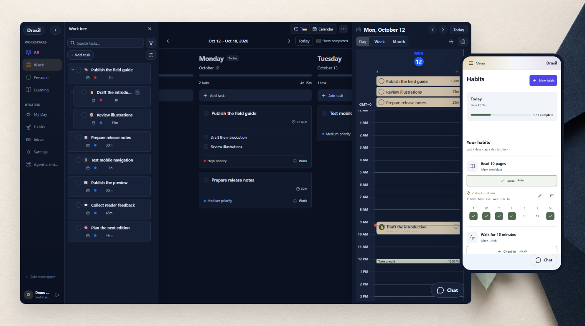
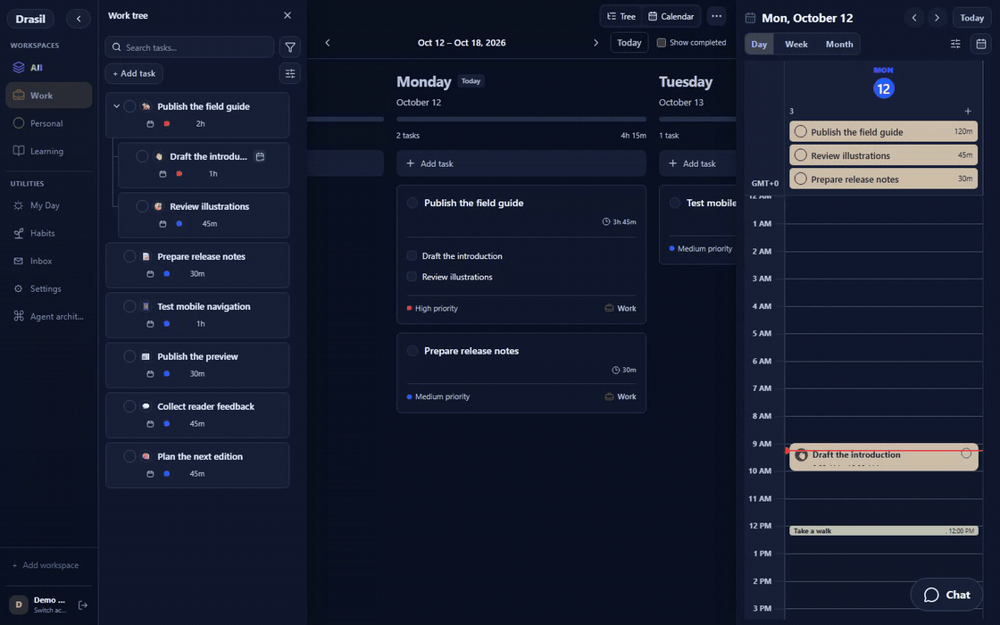
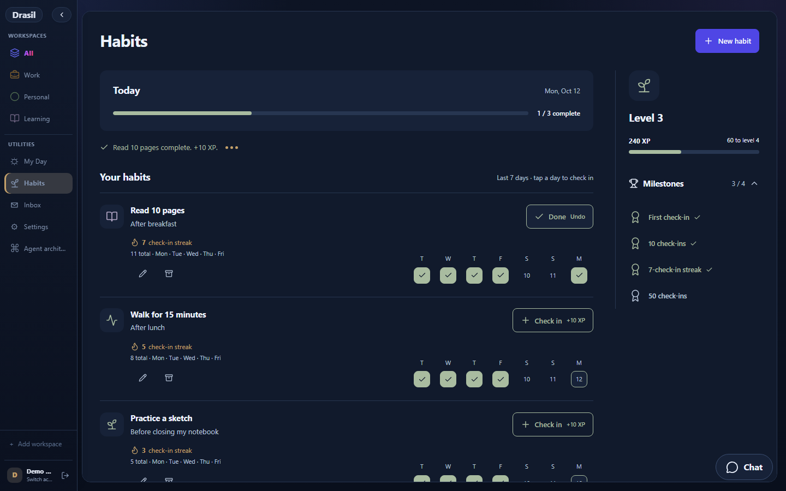

# Drasil

Plan tasks, arrange your week, and track habits. Review AI proposals before they change your workspace.



[Get started](#get-started) · [Hosting](docs/DEPLOYMENT.md) · [Recent updates](docs/RECENT_UPDATES.md) · [Contributing](CONTRIBUTING.md)

## See it work



Recorded from the current interface with fictional tasks and habits. AI responses and saves are mocked; no live account, model call, or calendar connection is used. [Demo details and recording instructions](docs/SHOWCASE.md).

## What you can do

- **Plan in a tree and a week.** Group tasks into workspaces and subtasks. Assign days, estimates, priorities, and deadlines. Keep tasks planned for later visible without counting them as today's work.
- **Make time for the work.** Use day, week, or month calendars. Move a task to another day while preserving its identity and booking duration. Remove a day assignment without deleting the task.
- **Review AI changes.** Chat in a floating window, inspect proposed before/after changes, then apply, revise, or reject. Conversations and drafts remain available when chat is minimized.
- **Track habits.** Choose weekdays, check in, follow streaks and XP, and undo a check-in. Rest days preserve streaks; archive preserves history. [Habit rules](docs/HABITS.md).
- **Use it on a phone.** A labeled Menu opens workspaces and utilities. Plan and Calendar use the screen width; forms and chat fit compact layouts. [Mobile behavior](docs/MOBILE.md).
- **Keep accounts separate.** Each account has its own planning data, provider credentials, and calendar connection. SQLite supports local/VPS installs; PostgreSQL supports hosted installs.



## Get started

Docker Compose runs the interface and API together. The default address is local to your machine.

```sh
git clone https://github.com/vbobus/Drasil-community.git
cd Drasil-community
cp .env.example .env
python -c "import secrets; print(secrets.token_urlsafe(32))"
```

Put the generated value in `DRASIL_BOOTSTRAP_TOKEN` in your private `.env`, then run:

```sh
docker compose up --build -d
```

Open <http://localhost:8000>, leave the backend address blank, and use the setup token to create the first administrator. Add accounts in **Settings > Accounts & server**. On Windows, use `Copy-Item .env.example .env` instead of `cp`.

Data stays in the `drasil-data` volume. `docker compose down` stops the service without removing that volume. Back up before upgrading. Drasil is under active development.

## Host your own instance

| Setup | Storage | Guide |
| --- | --- | --- |
| Local machine or VPS | Persistent Docker volume with per-account SQLite databases | [Docker, HTTPS, and backups](docs/DEPLOYMENT.md#docker-on-a-server) |
| Vercel + Neon | PostgreSQL account schemas and encrypted integration credentials | [Hosted setup](docs/HOSTING.md) |
| Separate static frontend | Authenticated connection to your HTTPS backend | [Split deployment](docs/DEPLOYMENT.md#separate-frontend) |
| Windows app and mobile browser | The same remote server and account | [Desktop and private remote access](docs/DESKTOP_AND_REMOTE_ACCESS.md) |

Tasks, calendars, and habits work without an AI connection. A source install can use an installed Codex CLI; the standard container supports the OpenAI API provider. Hosted ChatGPT/Codex access requires the optional account-scoped Sandbox setup in the hosting guide. API usage is separately billed and is never an automatic fallback.

## Develop locally

Use Python 3.14, Node.js 24, and npm 10 or newer.

```sh
python -m venv backend/venv
source backend/venv/bin/activate
python -m pip install -r backend/requirements.txt
cp backend/.env.example backend/.env
npm ci --prefix frontend
```

On Windows, activate with `./backend/venv/Scripts/Activate.ps1`. Then run in separate terminals:

```sh
cd backend
python -m uvicorn app.main:app --reload --host 127.0.0.1 --port 8000
```

```sh
cd frontend
npm run dev
```

Open <http://localhost:5173>. Windows users can run `./start.ps1` for the source setup.

## Project layout

React 19, TypeScript, Vite, and Zustand power the frontend. FastAPI, SQLModel, and OR-Tools handle data and scheduling. Docker and Vercel are deployment options; Electron provides the Windows shell.

```text
frontend/src/       Interface and client state
frontend/tests/     Browser scenarios with isolated fixtures
backend/app/        API, storage, scheduling, and agent services
backend/tests/      Public backend tests
desktop/            Windows shell
docs/               Hosting guides and fictional demo assets
scripts/            Build and public-export safety checks
```

## Checks

```sh
python -m pip install -r backend/requirements-dev.txt
ruff check backend/app
python -m unittest discover -s backend/tests -p "test_*.py"
npm --prefix frontend run lint
npm --prefix frontend run build
npm --prefix frontend run test:e2e:local
python scripts/verify_public_export.py .
python scripts/test_public_export.py
```

Backend tests use isolated databases. Set `DRASIL_TEST_ISOLATED_DB=1` when running them with an unusual runner; never enable it on a real server. CI also checks dependencies, the public tree, secrets, and packaging.

Run the public-tree check on a clean checkout or export before installing dependencies. It intentionally rejects local dependency, build, and test-output directories.

## Contribute

See [CONTRIBUTING.md](CONTRIBUTING.md) and the [Code of Conduct](CODE_OF_CONDUCT.md). Report vulnerabilities through GitHub's private **Security > Report a vulnerability** flow; see [SECURITY.md](SECURITY.md).

The Community export excludes account databases, credentials, real environment files, personal incident records, private evaluations, logs, and browser traces. Do not add these to a contribution or issue. The demo contains fictional data only.

[Apache 2.0](LICENSE) · [Attribution](NOTICE)
