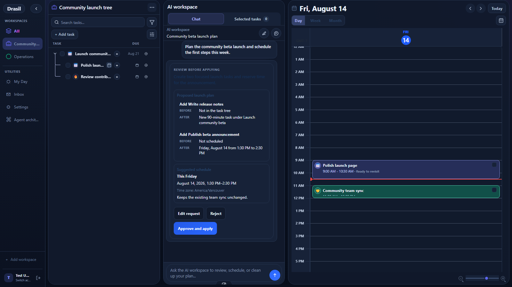
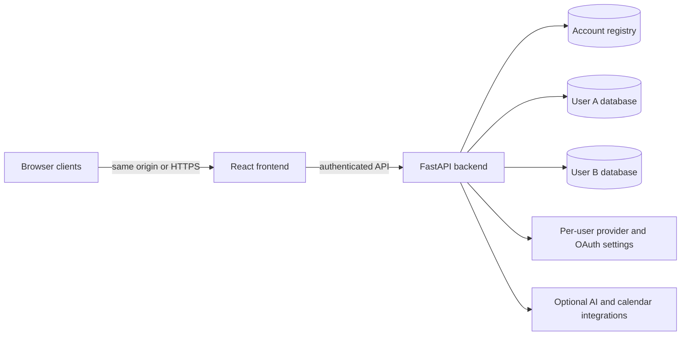

<p align="center">
  
</p>

<h1 align="center">Drasil</h1>

<p align="center">
  <strong>A local-first planning workspace that turns goals into structured work and realistic schedules.</strong>
</p>

<p align="center">
  Plan in trees. Execute on a calendar. Use AI through reviewable, approval-gated changes.
</p>

<p align="center">
  <a href="https://github.com/vbobus/Drasil-community/actions/workflows/ci.yml"></a>
  <a href="LICENSE"></a>
  
  
  
  
</p>

<p align="center">
  <a href="#quick-start">Quick start</a> ·
  <a href="#features">Features</a> ·
  <a href="#demo">Demo</a> ·
  <a href="#deployment">Deployment</a> ·
  <a href="docs/DEPLOYMENT.md">Documentation</a> ·
  <a href="CONTRIBUTING.md">Contributing</a>
</p>

> [!IMPORTANT]
> Drasil is under active development. Back up local data before upgrading and
> review AI-generated changes before applying them.

## Why Drasil?

Most planning tools make you choose between a flexible task list, a calendar,
or an AI chat window. Drasil keeps all three connected:

- **Structure the goal** as a hierarchy of workspaces, tasks, and subtasks.
- **Make the plan realistic** with priorities, estimates, dependencies,
  recurrence, and constraint-based scheduling.
- **Execute from time** with day, week, and month calendar views.
- **Ask for help safely** through AI proposals that remain reviewable before
  anything is written.
- **Keep control of the data** in local SQLite databases with separate storage
  and private configuration for every account.

## Demo

<p align="center">
  
</p>

<p align="center"><em>Actual Drasil AI approval flow captured from the running application with isolated fictional demo data.</em></p>

Drasil uses a focused three-panel workspace: the planning tree on the left, the
AI review surface in the middle, and the execution calendar on the right.

## Features

| Area | What Drasil provides |
| --- | --- |
| **Hierarchical planning** | Workspaces, task trees, subtasks, priorities, estimates, deadlines, dependencies, and search |
| **Calendar execution** | Day, week, and month views, drag-and-drop scheduling, recurring blocks, rollover state, and hierarchy-aware details |
| **AI workspace** | Strategist and planner workflows, remembered preferences, typed proposals, and explicit review before writes |
| **Constraint scheduling** | OR-Tools-backed scheduling that respects duration, availability, recurrence, and conflicts |
| **Multi-user instances** | Multiple accounts on one server, an in-app account switcher, administrator setup, and separate private data per account |
| **Provider choice** | Local Codex CLI authentication for source installs or user-configured OpenAI API access |
| **Calendar integration** | Optional Google Calendar connection with account-isolated OAuth tokens |
| **Flexible hosting** | One container for frontend and backend, or a static frontend connected to a remote HTTPS backend |
| **Light and dark themes** | A responsive planning interface with saved per-browser appearance preferences |

## Quick start

The recommended setup is one container serving both the frontend and backend.

### 1. Clone and configure

```sh
git clone https://github.com/vbobus/Drasil-community.git
cd Drasil-community
cp .env.example .env
python -c "import secrets; print(secrets.token_urlsafe(32))"
```

Paste the generated value into `DRASIL_BOOTSTRAP_TOKEN` in `.env`. On Windows,
use `Copy-Item .env.example .env` instead of `cp`.

### 2. Start Drasil

```sh
docker compose up --build -d
docker compose ps
```

### 3. Create the first account

Open <http://localhost:8000>, leave the backend-address field blank, enter the
setup token, and create the first administrator. Additional people can be added
under **Settings > Accounts & server**.

The default binding is `127.0.0.1`, so Drasil is reachable only from the same
machine. Data is stored in the named `drasil-data` Docker volume. No database
download or initialization command is required.

```sh
# View logs
docker compose logs -f drasil

# Stop the application without deleting its data volume
docker compose down
```

> [!NOTE]
> The standard container supports the OpenAI API provider. The Codex CLI is not
> bundled into the image; ChatGPT/Codex-login support in a container requires a
> custom image. Source installs can use a Codex CLI already installed locally.

## Deployment

Drasil supports two layouts with the same codebase.

| Layout | Best for | How it works |
| --- | --- | --- |
| **One machine** | Personal use, a home server, or a small trusted group | One container serves the web interface and API from the same address. This is the simplest default. |
| **Gateway / split deployment** | A VPS, home lab, Tailscale network, or separately hosted frontend | The backend holds accounts and data; a static frontend connects to its explicit HTTPS address. |



Every application API request is authenticated. Each account receives a
physically separate SQLite database and configuration directory. For remote
access, keep port 8000 private and use Tailscale, an SSH tunnel, or an HTTPS
reverse proxy. Plain HTTP across a network is not safe for passwords or session
tokens.

See [Deployment and multi-user setup](docs/DEPLOYMENT.md) for VPS, reverse
proxy, CORS, backups, Google OAuth, migration, and separate-frontend guidance.

## Configuration

Copy `.env.example` for Docker Compose or `backend/.env.example` for a source
install. Common options include:

| Setting | Purpose |
| --- | --- |
| `DRASIL_BIND_ADDRESS` | Interface exposed by the container; defaults to loopback |
| `DRASIL_PORT` | Host port; defaults to `8000` |
| `DRASIL_BOOTSTRAP_TOKEN` | One-time secret used to create the first administrator |
| `DRASIL_CORS_ORIGINS` | Exact allowed frontend origins for split deployments |
| `STRATEGIST_PROVIDER` | `codex-cli` or `openai-api` |
| `OPENAI_API_KEY` | Optional server-wide OpenAI API default; users can configure their own key in the app |
| `GOOGLE_CALENDAR_CLIENT_ID` | Optional server-wide Google OAuth client identifier |
| `GOOGLE_CALENDAR_CLIENT_SECRET` | Optional server-wide Google OAuth client secret |

Never commit `.env`, `.secrets`, databases, OAuth files, provider settings, or
credentials. Users can configure their own provider keys inside Drasil; those
values remain in that account's private configuration directory.

## Source development

### Requirements

- Python 3.14
- Node.js 24 and npm
- Optional Codex CLI or OpenAI API key for live AI features
- Optional Google OAuth credentials for calendar synchronization

### Windows

```powershell
git clone https://github.com/vbobus/Drasil-community.git
Set-Location Drasil-community
Copy-Item backend/.env.example backend/.env
./start.ps1
```

`start.ps1` creates `backend/venv`, installs dependencies, and opens the backend
and frontend development servers.

### macOS and Linux

```sh
python -m venv backend/venv
source backend/venv/bin/activate
python -m pip install -r backend/requirements.txt
cp backend/.env.example backend/.env
npm ci --prefix frontend
```

Run these in separate terminals:

```sh
cd backend
./venv/bin/uvicorn app.main:app --reload --host 127.0.0.1 --port 8000
```

```sh
cd frontend
npm run dev
```

Open <http://localhost:5173>. Interactive API documentation is available at
<http://127.0.0.1:8000/docs>.

## Architecture

Drasil is intentionally deployable without hosted infrastructure:

- **Frontend:** React 19, TypeScript, Vite, Zustand, and Playwright
- **Backend:** FastAPI, SQLModel/SQLAlchemy, Pydantic, and Uvicorn
- **Planning engine:** OR-Tools constraint solving plus approval-gated agent workflows
- **Storage:** SQLite, with separate account databases and private directories
- **Packaging:** Docker Compose or independent source/static deployments

```text
backend/app/         FastAPI routes, domain models, and application services
backend/tests/       Backend unit and integration tests
frontend/src/        React application, state, components, and API client
frontend/tests/      Playwright end-to-end tests
docs/                Deployment guides and public documentation assets
scripts/             Public export and repository-safety checks
```

## Quality and security

Every pull request is checked by independent CI jobs for:

- backend tests and Ruff linting;
- frontend linting and production build;
- Playwright browser tests;
- Python and npm dependency audits;
- container builds;
- public-tree verification and secret scanning.

The public source is produced from a strict allowlist. It excludes personal
databases, environment files, credentials, internal development material,
private evaluation suites and fixtures, evaluation output, browser traces, and
generated test artifacts.

Report suspected vulnerabilities privately through GitHub's **Security >
Report a vulnerability** flow. See [SECURITY.md](SECURITY.md) for the security
model and reporting policy.

## Development checks

```sh
# Backend
python -m pip install -r backend/requirements-dev.txt
ruff check backend/app
python -m unittest discover -s backend/tests -p "test_*.py"
pip-audit -r backend/requirements.txt

# Frontend
npm ci --prefix frontend
npm --prefix frontend run lint
npm --prefix frontend run build
npm --prefix frontend run test:e2e:local
npm --prefix frontend audit --audit-level=high

# Public-tree safety
python scripts/verify_public_export.py .
```

Set `DRASIL_TEST_ISOLATED_DB=1` when invoking backend tests from unusual test
runners. The standard commands and CI already isolate test databases.

## Contributing

Contributions are welcome. Start with [CONTRIBUTING.md](CONTRIBUTING.md), search
existing issues and pull requests, and discuss substantial behavior or schema
changes before implementation. Participation is governed by our
[Code of Conduct](CODE_OF_CONDUCT.md).

Please never include personal data, real credentials, logs, private evaluation
material, or generated test artifacts in an issue or pull request.

## License

Drasil is licensed under the [Apache License 2.0](LICENSE). See [NOTICE](NOTICE)
for attribution details.
